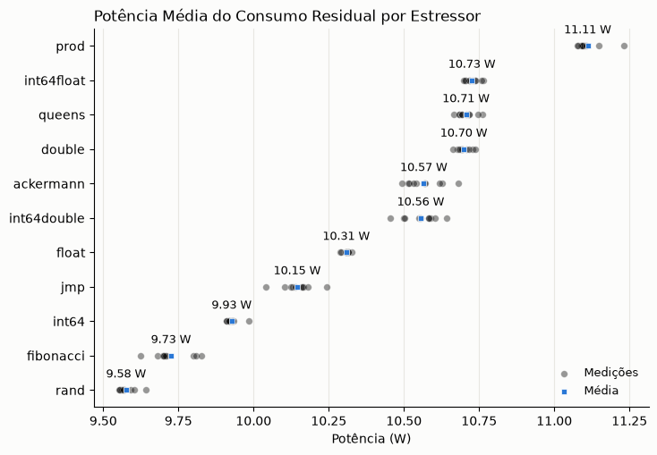
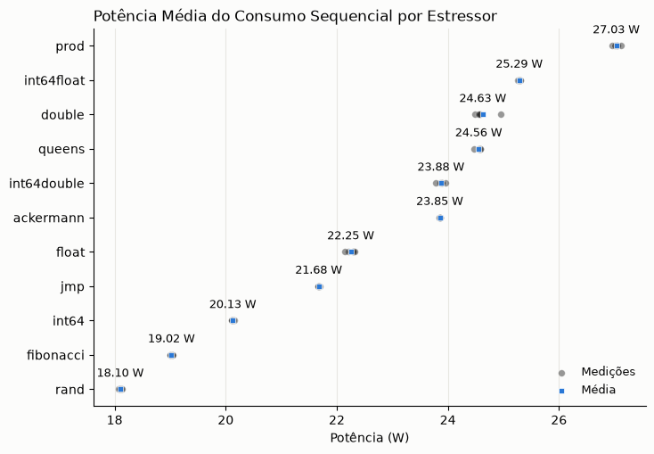
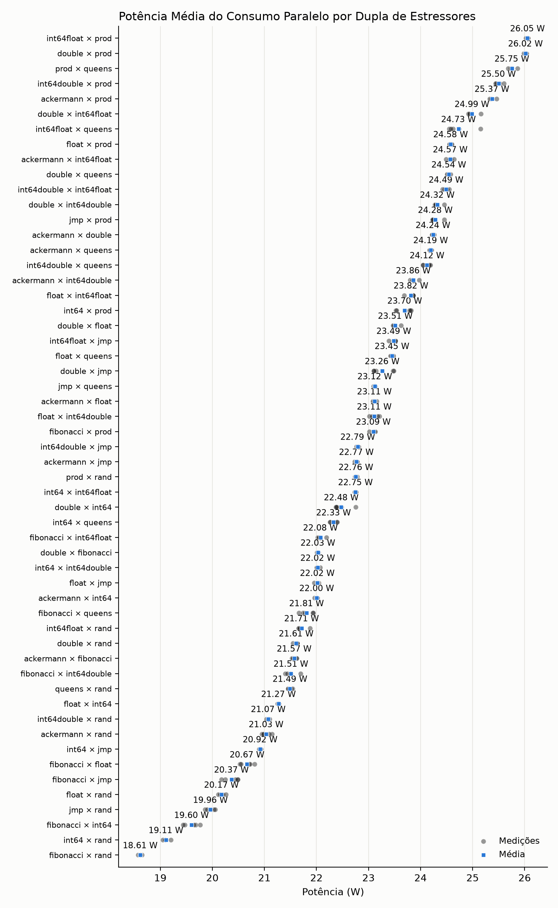
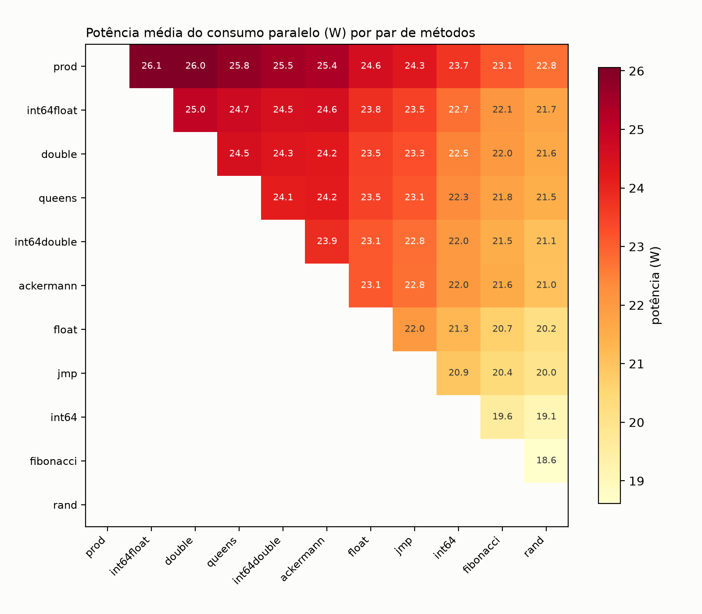
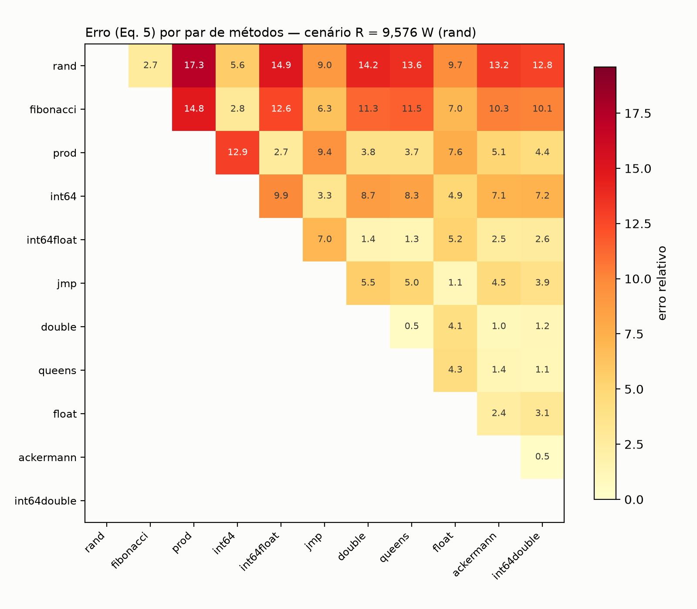
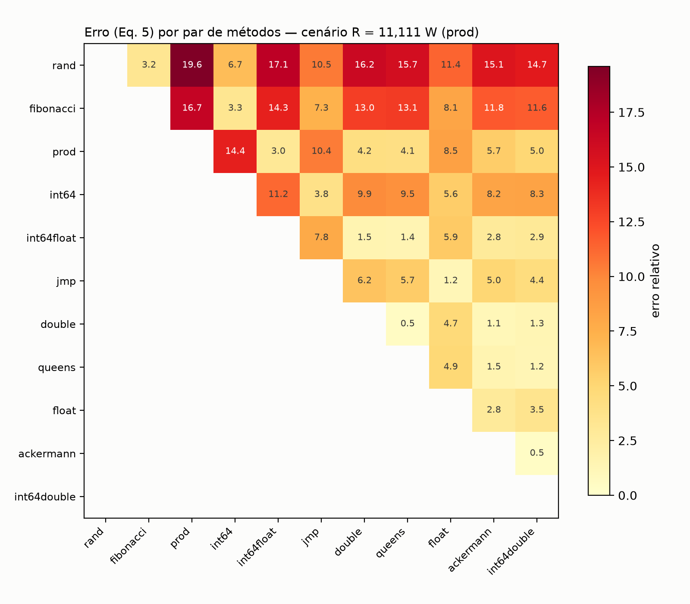
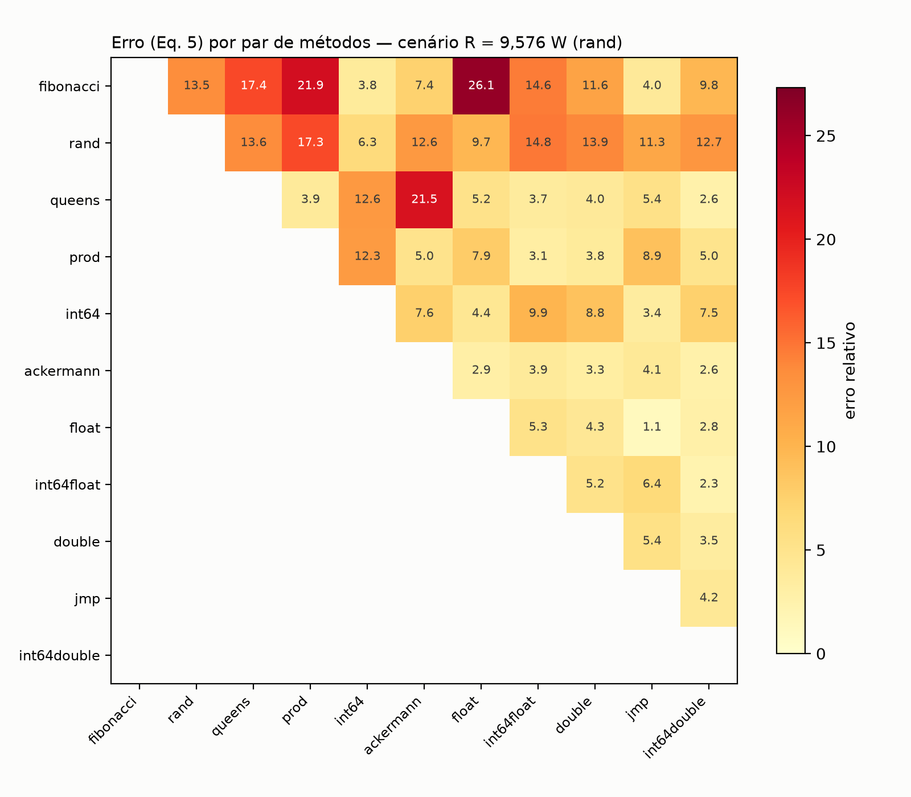
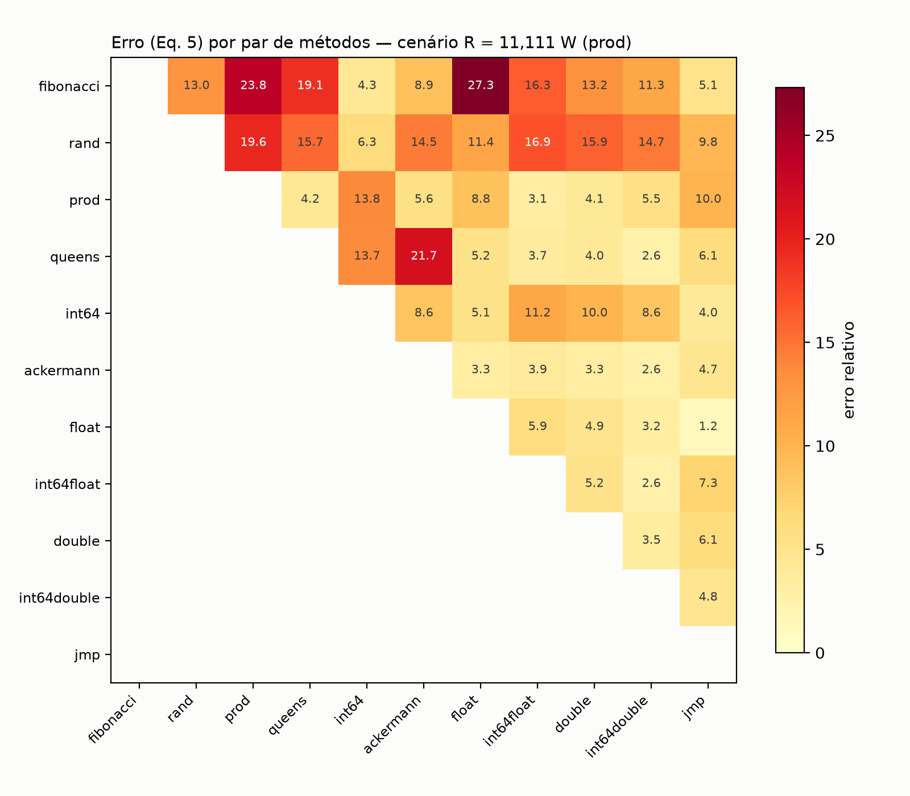

# LECOS
> Laboratório de Estudos em Computação Sustentável
---

O seguinte repositório contém os algoritmos necessários para executar o protocolo experimental proposto por:

* CADOREL, Emile; SAINGRE, Dimitri. A protocol to assess the accuracy of process-level power models. In: 2024 IEEE International Conference on Cluster Computing (CLUSTER). IEEE, 2024. p. 74-84

Esta branch (`code/protocolo-avaliacao-power-models`) implementa e automatiza esse protocolo, implementando as etapas de: isolamento do ambiente bare-metal, coleta do consumo real via RAPL, coleta do consumo estimado por dois modelos de rateio de energia por processo (**Scaphandre** e **PowerAPI**) e o cálculo do erro (Equação 5 do artigo) para os dois, nos 55 pares possíveis entre as 11 cargas de teste do `stress-ng` usadas como aplicações. 

As etapas implementadas e os resultados obtidos foram apresentados na **15º Semana de Integração Acadêmica (SIAC) da Universidade Federal do Rio de Janeiro (UFRJ)**, durante a Sessão Oral de Segurança da Informação, Arquitetura de Sistemas e Redes.


Inicialmente, utilizaremos um ambiente bare-metal com Ubuntu Server e processador 12th Gen Intel(R) Core(TM) i5-12400

# Passos para a execução do protocolo:

**Leia Antes de Executar os Scripts**: Durante a execução do isolamento da máquina, o wifi/tailscale é desativado. Assim, nunca execute o script diretamente em terminal via ssh, pois isso irá causar o encerramento da sessão e a conexão será perdida, sem que a placa de rede e os serviços de rede sejam reativados. Siga [esses passos](#obs-sessões-de-terminais-persistentes) para a execução em ambiente ssh.

## 0. Configurações Iniciais:

### 1. Clone o repositório
```bash
git clone --single-branch --branch code/protocolo-avaliacao-power-models https://github.com/luizpcsilva/LECOS.git
```

### 2. Crie o ambiente virtual e instale as dependências
```bash
cd LECOS
python3 -m venv venv
venv/bin/pip install -r requirements.txt
```
Todos os scripts Python do protocolo são chamados via `venv/bin/python` (ver `protocolo.sh`). As dependências são só `pandas` e `psutil` (`requirements.txt`).

### 3. Dê permissão de execução para protocolo.sh
```bash
sudo chmod +x protocolo.sh
```

## 1. Isolamento da Máquina

Para diminuir o ruído de fundo do sistema, é importante implementar medidas como o desligamento de atualizações de sistema, controle de temperatura, etc. As boas práticas de medição identificadas estão descritas [aqui - seção 1.3.4](https://doi.org/10.5753/sbc.20175.9.1)

Assim, desenvolvemos o script bash `protocolo.sh`. O script executa os seguintes passos:

### Desligamento de serviços de fundo:

Os seguintes serviços do SO são desligados para evitar interrupções de sistema durante a medição de energia:

1. `cron`: Evita a execução de tarefas agendadas do SO e rotinas de manutenção inesperadas.
2. `snapd` e `snapd.socket`: Interrompem a verificação e o download de atualizações automáticas do SO.
3. `docker` e `docker.socket`: desliga o daemon do Docker. Ele é religado explicitamente mais adiante, só para a fase de medição com o Scaphandre (o contêiner do Scaphandre depende dele).
4. `ModemManager`, `wpa_supplicant` e `tailscaled`: Silencia o gerenciamento de conexões de rede e Wi-Fi, garantindo que o sistema não gaste energia tentando reestabelecer conexões derrubadas.
5. `udisks2`, `upower` e `multipathd`: Desativam o monitoramento dos discos e de energia.
6. `prometheus`: desliga o serviço de monitoramento instalado na máquina de testes, para que ele não dispute recursos durante a medição.
7. `unattended-upgrades`: Bloqueia a instalação silenciosa de pacotes de segurança.

### Desligamento físico da placa de rede:

Para o desligamento total da conexão wifi, as placas físicas devem ser desligadas. O script `isolamento.sh` as identifica por meio do comando `INTERFACES_FISICAS=$(ls /sys/class/net/ | grep -E '^(en|wl|eth)')` e, em seguida, as desativa por meio de um loop for.

### Desligamento do Turboboost e Hyperthreading
A desativação do Turbo Boost impede que a frequência do processador exceda o valor base, estabilizando o consumo. A desativação do Hyper‑Threading garante que cada processo seja alocado a um núcleo físico exclusivo, sem concorrência de threads.
```bash
echo "1" > /sys/devices/system/cpu/intel_pstate/no_turbo   # desativa Turbo Boost
echo off > /sys/devices/system/cpu/smt/control              # desativa Hyper‑Threading
```

### Restauração Automática:
A função `restaurar_ambiente()` é chamada ao final do script (ou em caso de erro) para:
1. Religar as placas de rede.
2. Reativar o Turbo Boost e o Hyper‑Threading.
3. Reiniciar os serviços desligados.

### OBS: Sessões de Terminais Persistentes

Caso os scripts sejam executados via ssh, é importante que sejam utilizadas sessões de terminais persistentes para que, ao interromper os serviços de rede, a execução do script não seja abortada pelo fim da conexão ssh.

Assim, deve-se utilizar ferramentas conhecidas como multiplexadores de terminal. No caso, utilizaremos o `tmux`. Execute `tmux` no terminal ao logar no ssh para abrir o terminal tmux, identificado por uma barra verde no canto inferior da tela. Utilize-o como um terminal comum.

Caso saia da sessão, use o comando `tmux ls` para listar as sessões abertas e `tmux attach-session -t [numero da sessão]` para relogar

## Medição idle
Executa scripts/medicao-idle.py por 30 segundos, com amostragem de 1 segundo. O script:

1. Lê o contador RAPL /sys/class/powercap/intel-rapl/subsystem/intel-rapl:0/energy_uj a cada segundo.

2. Salva os dados em testes/idle/idle_YYYYMMDD_HHMMSS.csv.

3. Chama scripts/calculo-melhor-media-e-std.py para selecionar a janela de 10 s com menor desvio padrão e retornar a média de potência (em watts). A média definitiva é salva em `log.csv`.

Esse valor é usado apenas para referência. O consumo residual é medido separadamente e contém o idle.

## Medição Residual

Executa scripts/medicao-estressor.py com o comando:

```bash
taskset -c 0 stress-ng --cpu 1 -t 30
```

Isso gera carga em apenas um núcleo (core 0) por 30 s. O script mede o consumo total e extrai a melhor média (janela de 10 s com menor desvio padrão). Esse valor é chamado `CONSUMO_RESIDUAL` e corresponde a R (consumo total com um único núcleo ativo, incluindo o idle).

O valor é salvo no log.csv pelo script scripts/salvar-residual.py

**OBS:** o artigo não especifica com qual estressor medir `R`. `agendador_residual.sh` resolve isso medindo com os 11 estressores do protocolo (15 execuções cada, 165 medições no total), alternando `ESTRESSOR_RESIDUAL` em `valores.sh` a cada passo. O resultado, em `dados/log-consumo-residual.csv`, mostra que `R` varia visivelmente por método:



Portanto, decidimos não escolher um valor arbritário de consumo residual e, no restante da execução, existirão os **dois cenários**  extremos observados  **R mínimo = 9,5762 W** (método `rand`) e **R máximo = 11,1111 W** (método `prod`). 

## Medição das Aplicações Isoladas
Para cada aplicação a ser avaliada (ex: stress-ng --cpu 6, stress-ng --matrix 6), o script:

1. Executa o estressor por 30 s usando scripts/medicao-estressor.py.
2. Obtém o consumo total médio (CONSUMO_TOTAL_P1, CONSUMO_TOTAL_P2).
3. Calcula o consumo ativo com scripts/calculo-consumo-ativo.py:
```
CONSUMO_ATIVO_P1 = CONSUMO_TOTAL_P1 - CONSUMO_RESIDUAL
CONSUMO_ATIVO_P2 = CONSUMO_TOTAL_P2 - CONSUMO_RESIDUAL
``` 

**Testagem em Massa:** `agendador_estressor.sh` percorre os mesmos 11 estressores, 15 execuções cada (165 medições), e grava o resultado em `dados/log_medicao_sequencial.csv`:



## Medição Paralela
Executa as duas aplicações simultaneamente, mas com metade da quantidade de workers cada para evitar concorrência.

O consumo total paralelo (`CONSUMO_TOTAL_P1_P2`) é medido e o consumo ativo paralelo é calculado subtraindo o residual.

**Testagem em Massa:** `agendador_estressor_paralelo.sh` percorre as 55 duplas possíveis entre os 11 estressores realizando 5 medições para cada dupla (275 medições no total), gravando em `dados/log_medicao_paralela.csv`. `dados/paralela.csv` é a versão já tratada desse log, usada pelas próximas etapas:




## Consumo Ativo nos Dois Cenários de Residual (R mínimo e máximo)

Como visto em "Medição Residual", o cálculo do consumo ativo (`A = C − R`) é realizado para os
dois cenários de `R` (mínimo e máximo), em vez de um valor único. Mais detalhes da decisão em
[`dados/consumo-ativo/README.md`](dados/consumo-ativo/README.md).

`dados/consumo-ativo/gerar_consumo_ativo.ipynb` subtrai cada um dos dois valores de `R` do
consumo medido na fase paralela (`dados/paralela.csv`) e na fase isolada
(`dados/log_medicao_sequencial.csv`), depois agrega por método (isolado) e por par (paralelo):

Os valores calculados de consumo ativo estão dispostos da seguinte forma no repositório:
```
dados/consumo-ativo/ativo-R{min,max}-sequencial.csv    # consumo ativo por execução, isolado
dados/consumo-ativo/ativo-R{min,max}-paralelo.csv      # consumo ativo por execução, em par
dados/consumo-ativo/media_sequencial_{min,max}.csv     # média por método (11 linhas)
dados/consumo-ativo/media_paralelo_{min,max}.csv       # média por par (55 linhas)
```

## Cálculo do Baseline
O script scripts/calculo-baseline.py recebe:
* `CONSUMO_ATIVO_P1_P2`: consumo ativo total no cenário paralelo.
* `CONSUMO_ATIVO_P1` e `CONSUMO_ATIVO_P2`: consumos ativos individuais.

E calcula a divisão proporcional esperada, com base na equação 3 do artigo (CADOREL; SAINGRE, já citado):

```
baseline_p1 = consumo_ativo_paralelo * (consumo_ativo_p1 / (consumo_ativo_p1 + consumo_ativo_p2))
baseline_p2 = consumo_ativo_paralelo * (consumo_ativo_p2 / (consumo_ativo_p1 + consumo_ativo_p2))
```
Esses valores são impressos e salvos no `log.csv` numa rodada isolada do `protocolo.sh`.

**Cálculo em Massa** para os 55 pares, `calcular-baseline.ipynb` chama esse mesmo script uma vez por par, em cada um dos dois cenários de `R`, usando as médias geradas no passo anterior (`dados/consumo-ativo/media_sequencial_*.csv` e `media_paralelo_*.csv`). O resultado é salvo em `dados/baseline/baseline-Rmin.csv` e `dados/baseline/baseline-Rmax.csv`, e é esse par de arquivos que a Equação 5 usa como referência (ver "Cálculo do Erro").

## Medição com o Scaphandre

Roda **o mesmo cenário paralelo** da etapa anterior (`ESTRESSOR_1_PAR` e `ESTRESSOR_2_PAR`),
desta vez com o Scaphandre medindo, para obter o consumo **estimado pelo modelo** (`Ce`) de
cada aplicação. É contra esses valores que o baseline será comparado. Como a fase paralela,
essa medição roda dentro do mesmo `agendador_estressor_paralelo.sh` com os dados salvos em `dados/log_medicao_scaphandre.csv`.

O `scripts/medicao-scaphandre.py` sobe o contêiner do Scaphandre com o **exportador JSON**,
dispara os dois estressores e agrega o consumo de cada um.

Segue abaixo a chamada do scaphandre utilizada no script

```bash
docker run --rm --name scaphandre_json --privileged \
    -v /sys/class/powercap:/sys/class/powercap \
    -v /proc:/proc \
    hubblo/scaphandre json -s 1 --max-top-consumers 50 --resources
```

Os dados brutos vão para `testes/scaphandre/<cenário>-<timestamp>.csv`. Além de `ce_p1_uw` e
`ce_p2_uw`, o CSV traz demais colunas:

| Coluna | Para que serve |
|---|---|
| `socket0_uw` | domínio *package* **mesma base** que o protocolo lê do RAPL em `intel-rapl:0` |
| `host_uw` | consumo do host; é PSYS quando a placa expõe esse domínio |
| `soma_todos_uw` | `soma_todos / socket0` testa a premissa da Equação 4 |
| `cpu_p1_pct` / `cpu_p2_pct` | se `ce_p1/ce_p2 == cpu_p1/cpu_p2`, está demonstrado que a chave da divisão é tempo de CPU |
| `delta_t_s` | espaçamento de tempo entre amostras|
| `n_pids_p1` / `n_pids_p2` | quantos PIDs de cada árvore entraram na amostra |

Como nas demais etapas, a média sai da janela de 10 amostras mais estável.

## Medição com o PowerAPI

A coleta com o PowerAPI **não é automatizada neste repositório**. Ela foi feita manualmente, fora
deste código, rodando o PowerAPI sobre os mesmos 55 pares de estressores (5 execuções cada). O
resultado é `dados/resultados_powerapifinal.csv` (275 linhas; colunas `stressor_1`,
`stressor_2`, `data_hora`, `potencia_media_1_w`, `potencia_media_2_w`, `desvio_fracao`).

Uma célula de `dados/filtro.ipynb` converte esse CSV para o mesmo formato usado pelo
Scaphandre, para que o cálculo da Equação 5 (próxima seção) trate os dois modelos com o mesmo
código:

## Cálculo do Erro (Equação 5)

`calcular_erro.py` (Scaphandre) e `calcular_erro_powerapi.py` (PowerAPI), ambos na raiz do
repositório, aplicam a Equação 5 do artigo (CADOREL; SAINGRE, já citado) aos 55 pares, em cada
um dos dois cenários de `R`:

```
            Σ |Ce_Pi/C_S  −  A_Pi/(A_Pi+A_Pj)|
   AE_S  =  ─────────────────────────────────
                    dim(S) × T_S
```

Os dois termos vêm de fontes diferentes:

* **`Ce_Pi/C_S`** (o que o modelo atribuiu): `Ce_Pi` vem de `dados/log_medicao_scaphandre.csv`
  ou `dados/log_medicao_powerapi.csv` (médias de 5 execuções); `C_S` é aproximado pela potência
  média da própria fase paralela, em `dados/paralela.csv`.
* **`A_Pi/(A_Pi+A_Pj)`** (o que deveria ter sido atribuído): vem direto de
  `dados/baseline/baseline-Rmin.csv` / `baseline-Rmax.csv` (seção anterior).

Cada script calcula `|termo1 − termo2|` por par e por cenário, salva o detalhe e o resumo, e
imprime o pior par de cada cenário.

Os scripts de calculo de erro salvam, ao fim da execução, os seguintes arquivos de dados:

```
dados/erro-detalhado[-powerapi].csv   uma linha por (par, método, cenário) (comparação completa)
dados/erro-por-par[-powerapi].csv     uma linha por (par, cenário) (média entre P1 e P2)
dados/erro-resumo[-powerapi].csv      uma linha por cenário (média e máximo entre os 55 pares)
```

## Resultados

> Resultados apresentados na SIAC. Os números abaixo foram obtidos dos CSVs deste repositório (`dados/erro-resumo.csv`, `dados/erro-resumo-powerapi.csv`,
> `dados/erro-por-par.csv`, `dados/erro-por-par-powerapi.csv`).

### Erro medido no LECOS

55 pares, 5 execuções cada, nos dois cenários de `R` (ver "Medição Residual"). Os números
completos estão na tabela de "Comparação com o artigo-base" logo abaixo, que já junta LECOS e
artigo numa única tabela.

O pior par é diferente para cada modelo. Para o **Scaphandre** é `prod` × `rand` (Os dois
extremos do próprio consumo residual). Para o **PowerAPI** é `fibonacci` × `float`. Nos 10 pares em que `fibonacci` participa, o PowerAPI **sempre** sobrestima o quanto ele consome (71,1 % atribuídos contra 42,7 % esperados no par com `float`, cenário R mínimo).






### Comparação com o artigo-base

CADOREL; SAINGRE (já citado) avaliam o protocolo em duas máquinas (Small Intel e Dahu).

| Nome | Descrição |
|---|---|
| SMALL INTEL | 6 núcleos (12 lógicos) Intel(R) Xeon(R) W-2133 CPU, 32GB de RAM, SSD de 256GB |
| DAHU | 32 núcleos (64 lógicos) Intel Xeon Gold 6130 CPUs, 192GB de RAM, SSD de 240GB |
| LECOS | 6 núcleos (12 lógicos) Intel(R) Core(TM) i5-12400 de 12ª geração, 16GB de RAM, SSD NVMe de 256GB |

Erro (Equação 5) relatado pelos autores em cada máquina, contra o erro medido no LECOS. A
faixa de valores é decorrente dos dois cenários do Consumo Residual `R` (máximo ou mínimo):

| Fonte | Scaphandre médio | Scaphandre máx. | PowerAPI médio | PowerAPI máx. |
|---|---|---|---|---|
| CADOREL; SAINGRE — Small Intel | 3,15 % | 11,7 % | 3,12 % | 11,7 % |
| CADOREL; SAINGRE — Dahu | 2,7 % | 17,4 % | 16,23 % | 49,1 % |
| **LECOS** | **6,51 – 7,42 %** | **17,29 – 19,59 %** | **8,11 – 8,90 %** | **26,13 – 27,31 %** |

Os valores absolutos do LECOS e do artigo **não são diretamente comparáveis**, pois o hardware é
diferente e utilizamos uma faixa de `R` (Consumo Residual) em vez de um `R` único . 

Percebe-se que o modelo PowerAPI erra mais que o
Scaphandre. A causa do erro também se
repete. Os autores relatam o PowerAPI subestimando estressor`float64` quando ele é, isoladamente, um
dos métodos que mais consomem (o mesmo padrão aparece no LECOS, no par `fibonacci`/`float`.)

No Scaphandre, o par de estressores envolvido no maior erro se repete. O artigo aponta
que o erro máximo ocorre nos pares que juntam fibonacci (a função menos consumidora) com
uma das mais consumidoras (matrixprod, int64float ou jmp). No LECOS, esses mesmos
estressores aparecem nos piores pares do Scaphandre.
O pior par absoluto no LECOS,
porém, é prod × rand, não prod × fibonacci. Isso porque, nesta máquina, rand é o
estressor de menor consumo real, mais baixo até que fibonacci (ver tabela de postos
acima). Dos 8 piores pares de Scaphandre no LECOS, 6 envolvem rand; os outros 2 trocam
rand por outro parceiro de prod (fibonacci e int64). Ou seja, o princípio do
artigo, onde o menor consumidor pareado com um dos maiores é o que gera o pior caso também no
LECOS.

### Gráficos complementares

* [`graficos/residual-por-metodo.png`](graficos/residual-por-metodo.png) — ver "Medição Residual".
* [`graficos/sequencial-por-estressor.png`](graficos/sequencial-por-estressor.png) — ver "Medição das Aplicações Isoladas".
* [`graficos/consumo-paralelo.png`](graficos/consumo-paralelo.png) e [`graficos/consumo-paralelo-heatmap.png`](graficos/consumo-paralelo-heatmap.png) — ver "Medição Paralela".

## Trabalhos Futuros

Futuramente, vale modificar o protocolo para atender às práticas mais recentes, propostas por BELLAL, Z. et al. Investigating the Potential of Kepler Toward Power Observability for Sustainable Cloud Computing. IEEE Transactions on Green Communications and Networking, v. 10, 2026, p. 2118-2135. São elas, por exemplo:

* Desativação de C-states (estados ociosos profundos), que afetam o consumo do pacote.
* Frequência de uncore fixa.
* Variação de co-runners e cargas memory-bound.
* Análise por domínio RAPL (PKG vs. DRAM), em vez de só o pacote inteiro.